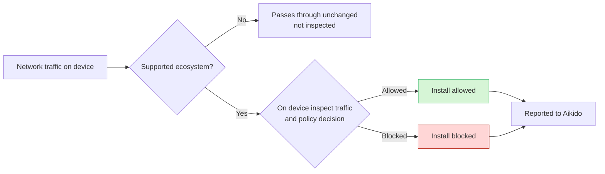

# How Does Device Protection Work?

Aikido Device Protection installs a lightweight Layer 4 proxy on each device. It only inspects traffic to supported package registries, plus AI providers when AI Usage monitoring is enabled. Everything else bypasses it. The agent also scans local files on the device for hardcoded secrets.



## How it works

### Decisions happen on the device

All allow and block decisions happen locally. Aikido does not receive your traffic, browsing history, or downloaded files.

The agent downloads only the data it needs to enforce policy:

* **Allowlists and blocklists**
* **Malware signatures**
* **Policy rules and exceptions**

After that sync, the device can enforce rules on its own.

### Only supported ecosystems are intercepted

The proxy is not a general web filter. It only intercepts [supported package ecosystems](/aikido-device-protection/miscellaneous-aikido-endpoint/supported-ecosystems.md), plus AI provider domains when AI Usage monitoring is enabled.

These domains are served over HTTPS. To inspect them, the agent uses a local Certificate Authority (CA) on the device, which is only used for the domains below. See [Certificates](#certificates).

These are the domains Aikido Device Protection intercepts. Package registries and developer tool marketplaces are always intercepted. AI provider domains are only intercepted when [AI Usage](/aikido-device-protection/using-aikido-endpoint/ai-monitoring.md) monitoring is enabled.




```
api.nuget.org
app.aikido.dev
endpoint-server.aikido.dev
aikido-endpoint-binaries.s3.eu-west-1.amazonaws.com
central.maven.org
chromewebstore.google.com
chromewebstore.googleapis.com
clients2.google.com
clients2.googleusercontent.com
crates.io
index.crates.io
static.crates.io
device-protection.aikido.help
files.pythonhosted.org
gallery.vsassets.io
gallerycdn.vsassets.io
github.com
globalcdn.nuget.org
marketplace.cursorapi.com
marketplace.visualstudio.com
open-vsx.org
proxy.golang.org
pypi.org
pypi.python.org
registry.npmjs.com
registry.npmjs.org
registry.yarnpkg.com
repo.maven.apache.org
repo1.maven.org
repository.apache.org
rubygems.org
index.rubygems.org
repo.packagist.org
sum.golang.org
update.googleapis.com
www.nuget.org
```




Only intercepted when AI Usage monitoring is enabled.

```
ai-gateway.helicone.ai
ai-gateway.vercel.sh
ai.zenifra.com
aki.io
api-inference.modelscope.cn
api-sherlock.cloudferro.com
api.302.ai
api.abliteration.ai
api.ai-router.dev
api.aiand.com
api.ambient.xyz
api.anyapi.ai
api.auriko.ai
api.berget.ai
api.cerebras.ai
api.clarifai.com
api.claudin.io
api.cline.bot
api.code.umans.ai
api.cortecs.ai
api.crossmodel.ai
api.deepinfra.com
api.deepseek.com
api.dinference.com
api.empiriolabs.ai
api.fireworks.ai
api.friendli.ai
api.getlilac.com
api.githubcopilot.com
api.gmi-serving.com
api.greenpt.ai
api.groq.com
api.hpc-ai.com
api.impossibl.com
api.inceptionlabs.ai
api.inceptron.io
api.inference.wandb.ai
api.intelligence.io.solutions
api.jiekou.ai
api.kilo.ai
api.lkeap.cloud.tencent.com
api.llama.com
api.llmgateway.io
api.longcat.chat
api.lucidquery.com
api.meganova.ai
api.meta.ai
api.mistral.ai
api.modeloracle.com
api.moonshot.ai
api.moonshot.cn
api.morphllm.com
api.neuralwatt.com
api.nova.amazon.com
api.novita.ai
api.ofox.ai
api.openai-compat.model-serving.eu01.onstackit.cloud
api.orcarouter.ai
api.perplexity.ai
api.pioneer.ai
api.poe.com
api.qhaigc.net
api.qnaigc.com
api.regolo.ai
api.routing.run
api.sakana.ai
api.sarvam.ai
api.scaleway.ai
api.scx.ai
api.siliconflow.cn
api.siliconflow.com
api.stepfun.ai
api.stepfun.com
api.synthetic.new
api.tbox.cn
api.tensorx.ai
api.thegrid.ai
api.together.xyz
api.tokenfactory.nebius.com
api.trustedrouter.com
api.unorouter.com
api.upstage.ai
api.vivgrid.com
api.vultrinference.com
api.xiaomimimo.com
api.z.ai
api.zeldoc.ai
apis.iflow.cn
app.frogbot.ai
chat.d.run
cloud-api.near.ai
coding-intl.dashscope.aliyuncs.com
coding-plan-endpoint.kuaecloud.net
coding.dashscope.aliyuncs.com
crof.ai
daoxe.com
dashscope-intl.aliyuncs.com
dashscope.aliyuncs.com
go.fastrouter.ai
hyper.charm.land
inference.baseten.co
inference.coralbricks.ai
inference.do-ai.run
inference.hetzner.com
inference.net
inference.poolside.ai
inference.tinfoil.sh
inference.us-west.modal.direct
integrate.api.nvidia.com
kenari.id
llm.chutes.ai
llm.submodel.ai
llmtr.com
maas-api.ebcloud.com
moark.com
model.inferx.net
modelishub.com
models.mixlayer.ai
models.think.evroc.com
nano-gpt.com
oai.endpoints.kepler.ai.cloud.ovh.net
ollama.com
open.bigmodel.cn
openai.blueclaw.network
opencode.ai
openrouter.ai
pass.wafer.ai
routellm.abacus.ai
router.huggingface.co
router.requesty.ai
token-plan-ams.xiaomimimo.com
token-plan-cn.xiaomimimo.com
token-plan-sgp.xiaomimimo.com
token-plan.ap-southeast-1.maas.aliyuncs.com
token-plan.cn-beijing.maas.aliyuncs.com
tokenhub.tencentmaas.com
www.xpersona.co
zenmux.ai
```




### Network requirements

The agent needs outbound internet access to reach Aikido. Allowlist `*.aikido.dev` over HTTPS on port 443.

## Data Aikido receives

### Install outcomes and SBOM

Package contents and general browsing stay on the device. The agent only reports:

* Allowed installs
* Blocked installs
* Flagged installs
* Installed packages

Install outcomes are reported immediately. Installed packages are compiled into an SBOM (software bill of materials, the inventory of packages in use), generated and synced once a day. The agent also sends a heartbeat every 10 minutes so you know it's online.

### AI features

When [AI Usage](/aikido-device-protection/using-aikido-endpoint/ai-monitoring.md) monitoring is enabled, the agent also inspects traffic to AI provider domains. Aikido receives the inventory only: the MCP servers, models, and tools that were used, and the devices they were used on.

### Secret scanning

[Secret Scanning](/aikido-device-protection/using-aikido-endpoint/secret-scanning.md) reads local files on the device, such as shell history. File contents are never uploaded. When a secret is detected, Aikido receives the type of secret and a few characters of the value, enough to recognize the finding. The full secret is never sent.

## Certificates

### How the CA works

Aikido uses a two-tier CA chain:

1. **Workspace CA:** the root of the chain, generated in Aikido and unique to your workspace. Your devices trust its public certificate. Its private key stays with Aikido.
2. **Device certificate:** short-lived, unique per device, and signed by your workspace CA. The proxy uses it to inspect package manager traffic.

Each device generates its own private key locally and sends only a signing request to Aikido. The private key never leaves the device. On macOS it is stored in Apple's protected storage (Secure Enclave / Keychain), so it can't be read or exported, even by the device owner.

Device certificates are valid for at most 4 days and are re-issued automatically before they expire. They can't sign further certificates, which is enforced at signing time. If one is ever extracted from memory, it expires quickly.

You don't need to distribute the workspace CA yourself. The MDM configuration profile and the installer package both include it, so it reaches the device trust store as part of a normal deployment.

**CA file location on macOS:**

`/Library/Application Support/AikidoSecurity/EndpointProtection/run/endpoint-protection-combined-ca.pem`

### Viewing your certificates

The [Certificates](https://app.aikido.dev/endpoint-protection/certificates) page in Aikido shows:

* **Root CA Certificate:** your workspace CA, with its SHA-256 fingerprint, creation and expiry dates, and the public certificate in PEM format.
* **Issued Certificates:** every device certificate signed by your workspace CA, with the device it was issued to, when it was issued, and its fingerprint.

Use this page to confirm a device is enrolled, or to check a certificate on a device against what Aikido issued.

## Signed agent updates

Every agent release is cryptographically signed in Aikido's build pipeline. Before installing an update, the updater verifies that signature and rejects tampered or unsigned builds. To install updates automatically, turn on [Auto-update](/aikido-device-protection/deploying-aikido-endpoint/connecting-and-managing-devices.md#auto-update).

* **macOS:** every binary and the installer package are signed with Aikido's Apple Developer ID and notarized by Apple.
* **Windows:** binaries are signed with Authenticode.

## Network filters on macOS

On macOS, **System Settings** → **Network** → **Filters** shows three Aikido entries per device. This is expected.

| Entry             | Created by                   | Expected state | Purpose                                                                                      |
| ----------------- | ---------------------------- | -------------- | -------------------------------------------------------------------------------------------- |
| Content filter    | MDM profile                  | *Disabled*     | For future protection support that Aikido is adding. Stays disabled until then.              |
| Transparent proxy | MDM profile                  | *Disabled*     | Pre-approves the Aikido system extension. Holds no configuration.                            |
| Transparent proxy | Aikido extension, at runtime | *Enabled*      | Holds the full proxy configuration, including auto-enable, which can only be set at runtime. |

Don't remove the disabled MDM entries. The runtime transparent proxy depends on the pre-approval they provide.

## Limitations

* **Device Protection is not a virus scanner.** Apart from Secret Scanning, it doesn't inspect files, processes, or your system for existing threats. It blocks malware before it reaches the device, so malware already on a device is not detected or removed. Consider that device compromised.
* **Docker containers:** not protected by default. Turn on **Protect Containers** to cover them. See [Device Protection in Docker Containers](/aikido-device-protection/deploying-aikido-endpoint/device-protection-in-docker-containers.md).
* **WSL2:** package installs inside WSL2 distros on Windows are not protected by default. Turn on **Protect WSL2** and Aikido installs the Linux agent into each running distro. WSL2 protection is available on request. See [Device Protection in WSL2](/aikido-device-protection/deploying-aikido-endpoint/device-protection-in-wsl2.md).
