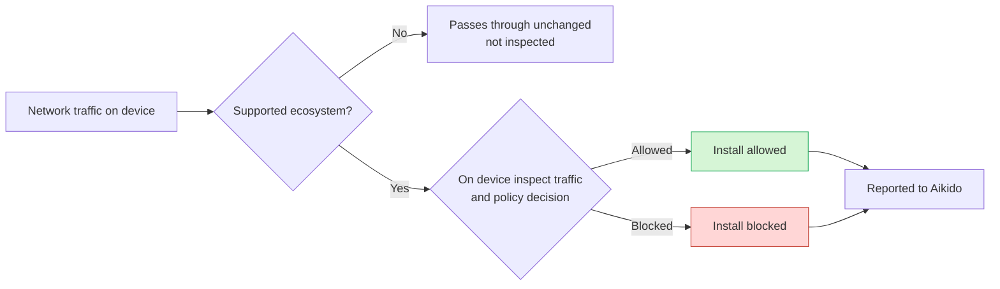

# How Does Device Protection Work?

Aikido Device Protection installs a lightweight Layer 4 proxy on each device. It only inspects traffic to supported package registries, and to AI providers when AI Usage monitoring is enabled. Everything else bypasses it. The agent also scans local files on the device for hardcoded secrets.



### Decisions happen on the device

All allow and block decisions happen locally. Aikido does not receive your traffic, browsing history, or downloaded files.

The agent downloads only the data it needs to enforce policy:

* **Allowlists and blocklists**
* **Malware signatures**
* **Policy rules and exceptions**

After that sync, the device can enforce rules on its own.

### What data Aikido receives and when

Package contents stay on the device, and general browsing stays invisible to Aikido. The agent only reports install outcomes and installed packages:

* Allowed installs
* Blocked installs
* Flagged installs
* Installed packages

Installed packages are compiled into an SBOM (a software bill of materials, the inventory of packages in use), generated and synced once a day. Install outcomes are reported immediately, and the agent sends a heartbeat every 10 minutes so you know it's online.

The agent needs outbound internet access to reach Aikido. Allowlist `*.aikido.dev` over HTTPS on port 443.

### AI features

When [AI Usage](/aikido-device-protection/using-aikido-endpoint/ai-monitoring.md) monitoring is enabled, the agent also inspects traffic to AI provider domains. Prompts are analyzed on the device to flag malicious ones. Aikido does not receive your prompts or your conversation history.

Aikido receives the inventory only: the MCP servers, models, and tools that were used, and the devices they were used on.

### Secret scanning

[Secret Scanning](/aikido-device-protection/using-aikido-endpoint/secret-scanning.md) reads local files on the device, such as shell history. File contents are never uploaded to Aikido.

When a secret is detected, Aikido receives the type of secret and a few characters of the value, enough for you to recognize the finding. The full secret is never sent.

### It only intercepts supported ecosystems

The proxy is not a general web filter. It only intercepts [supported package ecosystems](/aikido-device-protection/miscellaneous-aikido-endpoint/supported-ecosystems.md), plus AI provider domains when AI Usage monitoring is enabled. All other traffic passes through unchanged.

Those domains are served over HTTPS. To inspect that traffic, the agent uses a local Certificate Authority (CA) on the device. It is only used for the domains listed below.

These are the domains Aikido Device Protection intercepts. Package registries and developer tool marketplaces are always intercepted. AI provider domains are only intercepted when [AI Usage](/aikido-device-protection/using-aikido-endpoint/ai-monitoring.md) monitoring is enabled.




```
api.nuget.org
app.aikido.dev
endpoint-server.aikido.dev
aikido-endpoint-binaries.s3.eu-west-1.amazonaws.com
central.maven.org
chromewebstore.google.com
chromewebstore.googleapis.com
clients2.google.com
clients2.googleusercontent.com
crates.io
index.crates.io
static.crates.io
device-protection.aikido.help
files.pythonhosted.org
gallery.vsassets.io
gallerycdn.vsassets.io
github.com
globalcdn.nuget.org
marketplace.cursorapi.com
marketplace.visualstudio.com
open-vsx.org
proxy.golang.org
pypi.org
pypi.python.org
registry.npmjs.com
registry.npmjs.org
registry.yarnpkg.com
repo.maven.apache.org
repo1.maven.org
repository.apache.org
rubygems.org
index.rubygems.org
repo.packagist.org
sum.golang.org
update.googleapis.com
www.nuget.org
```




Only intercepted when AI Usage monitoring is enabled.

```
ai-gateway.helicone.ai
ai-gateway.vercel.sh
ai.zenifra.com
aki.io
api-inference.modelscope.cn
api-sherlock.cloudferro.com
api.302.ai
api.abliteration.ai
api.ai-router.dev
api.aiand.com
api.ambient.xyz
api.anyapi.ai
api.auriko.ai
api.berget.ai
api.cerebras.ai
api.clarifai.com
api.claudin.io
api.cline.bot
api.code.umans.ai
api.cortecs.ai
api.crossmodel.ai
api.deepinfra.com
api.deepseek.com
api.dinference.com
api.empiriolabs.ai
api.fireworks.ai
api.friendli.ai
api.getlilac.com
api.githubcopilot.com
api.gmi-serving.com
api.greenpt.ai
api.groq.com
api.hpc-ai.com
api.impossibl.com
api.inceptionlabs.ai
api.inceptron.io
api.inference.wandb.ai
api.intelligence.io.solutions
api.jiekou.ai
api.kilo.ai
api.lkeap.cloud.tencent.com
api.llama.com
api.llmgateway.io
api.longcat.chat
api.lucidquery.com
api.meganova.ai
api.meta.ai
api.mistral.ai
api.modeloracle.com
api.moonshot.ai
api.moonshot.cn
api.morphllm.com
api.neuralwatt.com
api.nova.amazon.com
api.novita.ai
api.ofox.ai
api.openai-compat.model-serving.eu01.onstackit.cloud
api.orcarouter.ai
api.perplexity.ai
api.pioneer.ai
api.poe.com
api.qhaigc.net
api.qnaigc.com
api.regolo.ai
api.routing.run
api.sakana.ai
api.sarvam.ai
api.scaleway.ai
api.scx.ai
api.siliconflow.cn
api.siliconflow.com
api.stepfun.ai
api.stepfun.com
api.synthetic.new
api.tbox.cn
api.tensorx.ai
api.thegrid.ai
api.together.xyz
api.tokenfactory.nebius.com
api.trustedrouter.com
api.unorouter.com
api.upstage.ai
api.vivgrid.com
api.vultrinference.com
api.xiaomimimo.com
api.z.ai
api.zeldoc.ai
apis.iflow.cn
app.frogbot.ai
chat.d.run
cloud-api.near.ai
coding-intl.dashscope.aliyuncs.com
coding-plan-endpoint.kuaecloud.net
coding.dashscope.aliyuncs.com
crof.ai
daoxe.com
dashscope-intl.aliyuncs.com
dashscope.aliyuncs.com
go.fastrouter.ai
hyper.charm.land
inference.baseten.co
inference.coralbricks.ai
inference.do-ai.run
inference.hetzner.com
inference.net
inference.poolside.ai
inference.tinfoil.sh
inference.us-west.modal.direct
integrate.api.nvidia.com
kenari.id
llm.chutes.ai
llm.submodel.ai
llmtr.com
maas-api.ebcloud.com
moark.com
model.inferx.net
modelishub.com
models.mixlayer.ai
models.think.evroc.com
nano-gpt.com
oai.endpoints.kepler.ai.cloud.ovh.net
ollama.com
open.bigmodel.cn
openai.blueclaw.network
opencode.ai
openrouter.ai
pass.wafer.ai
routellm.abacus.ai
router.huggingface.co
router.requesty.ai
token-plan-ams.xiaomimimo.com
token-plan-cn.xiaomimimo.com
token-plan-sgp.xiaomimimo.com
token-plan.ap-southeast-1.maas.aliyuncs.com
token-plan.cn-beijing.maas.aliyuncs.com
tokenhub.tencentmaas.com
www.xpersona.co
zenmux.ai
```




### How the CA works

Aikido uses a two-tier CA chain:

1. **Workspace CA:** the root of the chain, generated in Aikido and unique to your workspace. Its public certificate is what your devices trust, and its private key stays with Aikido.
2. **Device certificate:** short-lived and unique per device, signed by your workspace CA. This is what the proxy uses to inspect package manager traffic.

Each device generates its own private key locally and asks Aikido to sign a certificate for it. On macOS that key is stored in Apple's protected storage (Secure Enclave / Keychain), which prevents it from being read or exported, even by the device owner. The private key never leaves the device, only a signing request goes to Aikido.

Device certificates are valid for a maximum of 4 days and are re-issued automatically before they expire. If one is ever extracted from memory, it expires quickly and cannot be used to sign further certificates, which is enforced at signing time.

**CA file location on macOS:**

`/Library/Application Support/AikidoSecurity/EndpointProtection/run/endpoint-protection-combined-ca.pem`

### Viewing your certificates

The [Certificates](https://app.aikido.dev/endpoint-protection/certificates) page in Aikido shows:

* **Root CA Certificate:** your workspace CA, with its SHA-256 fingerprint, creation and expiry dates, and the public certificate in PEM format.
* **Issued Certificates:** every device certificate signed by your workspace CA, showing the device it was issued to, when it was issued, and its fingerprint.

You don't need to distribute the workspace CA yourself. The MDM configuration profile and the installer package both include it, so it reaches the device trust store as part of a normal deployment. Use this page to confirm a device is enrolled, or to check a certificate you're seeing on a device against what Aikido issued.

### Signed agent updates

Every agent release is cryptographically signed in Aikido's build pipeline. Before installing an update, the agent's updater verifies that signature, so a tampered or unsigned build is rejected.

* **macOS:** every binary and the installer package are signed with Aikido's Apple Developer ID and notarized by Apple.
* **Windows:** binaries are signed with Authenticode.

### Limitations

* **Aikido Device Protection is not a virus scanner.** Apart from Secret Scanning, it does not inspect files, processes, or your system for existing threats. Instead, it works by blocking malware before it can reach your device. This means that if malware is already present on a device, Aikido Device Protection will not detect or remove it, and the device should be considered compromised.
* **Docker containers:** enable **Protect Containers** to protect Docker. See [Device Protection in Docker Containers](/aikido-device-protection/deploying-aikido-endpoint/device-protection-in-docker-containers.md).
