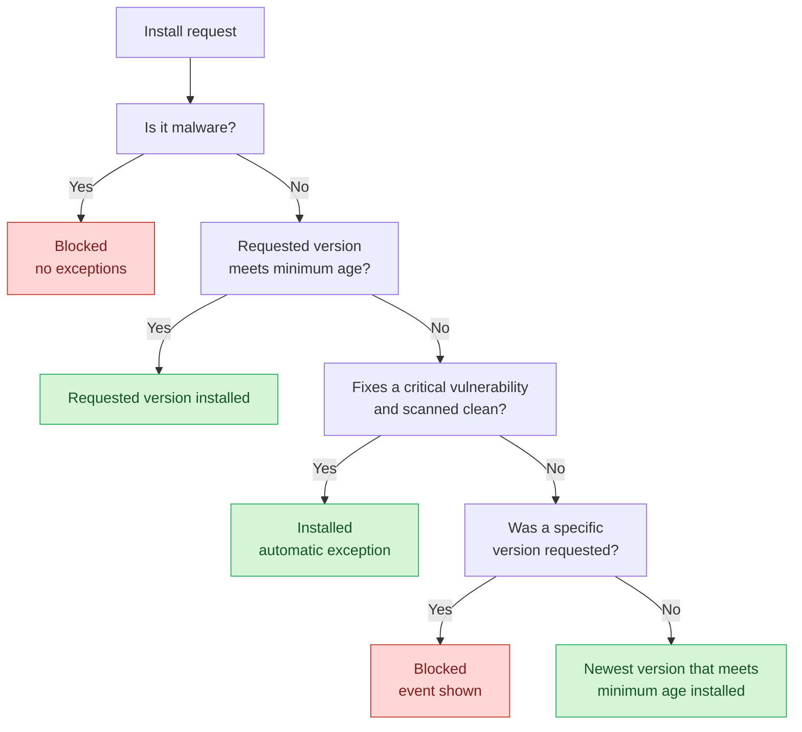

# Minimum Package Age & Version Fallback


Malware is **always** blocked, no matter its age or which version was requested. The behavior below only applies to packages that are not identified as malware.


The [Minimum Package Age](/aikido-device-protection/using-aikido-endpoint/configuring-installation-policies.md#minimum-package-age) policy sets how long a version must have existed before it can be installed. For example, with a minimum age of 24 hours, any version published less than 24 hours ago is considered **too new**.

What happens when a version is too new depends on how the install was requested: for a **specific version** or for the **latest** version.

## Specific version requested

When an install pins an exact version, Aikido can only accept or reject that exact version. There is nothing to fall back to.

* **Version meets the minimum age** → the install is **allowed**.
* **Version is too new** → the install is **blocked**, and an event is shown so you can see what was held back.

## Latest version requested

When an install asks for the latest version, Aikido has room to fall back. Instead of blocking outright, it returns the newest version that still meets the minimum age.

* **Latest version meets the minimum age** → the latest version is returned.
* **Latest version is too new** → Aikido falls back to the newest version that meets the minimum age, and that version is returned instead.

This keeps installs working while still holding back versions that are too new to have been vetted by the community.

## Critical security fixes

A version that fixes a **critical** vulnerability is allowed through even when it is too new, as long as Aikido has scanned it and found no malware.

Without this, the minimum age can work against you. A critical vulnerability is disclosed, the maintainer publishes a fix within hours, and your policy holds back the only version that is safe to install.

How it works:

1. A new version is published that fixes a critical vulnerability in an earlier version of that package.
2. Aikido scans the new version for malware.
3. If it is clean, Aikido adds it as an automatic exception to the minimum package age and the install is allowed.

You don't have to configure anything. The exception applies to that version only, and it does not change your minimum age policy.

## Decision flow


Need a specific new version that the minimum age policy is holding back? Add an exception and set its age limit to **Allow all versions (no age limit)**. See [Configuring Installation Policies](/aikido-device-protection/using-aikido-endpoint/configuring-installation-policies.md#exceptions).

