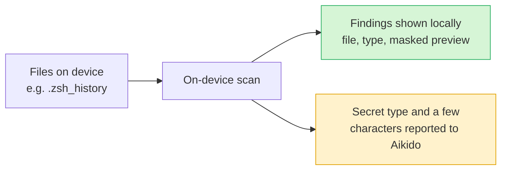

# Secret Scanning

Secret Scanning finds hardcoded secrets that have been left behind in local files on your team's devices, such as shell history files (`.zsh_history`, `.bash_history`), AI coding agent sessions, and credential files, and helps you clean them up. It's easy to accidentally leak an API key or token into your shell history by pasting a `curl` command or an environment variable, and those secrets can sit there for months.

The scan runs entirely on the device. It surfaces every finding so a developer can review it and remediate it directly on their own machine.

It doesn't crawl the whole disk. It only looks at the places secrets tend to pile up, such as history files and credential files. See [What gets scanned](#what-gets-scanned) for the full list.


Secret Scanning is part of Aikido Device Protection. If you haven't deployed the agent yet, see [Deploying Device Protection](/aikido-device-protection/deploying-aikido-endpoint.md).


## How it works

Secret Scanning is designed so that your secret values stay on the device.

* **Scanning is fully local.** The agent reads and inspects files on the device itself. File contents are never uploaded to Aikido.
* **Secret values stay on the device.** The full value of a detected secret is never transmitted. In the desktop client it is shown masked (for example `[AIK********...]`) so you can recognize it without exposing it.
* **Only the secret type and a few characters are reported.** Aikido receives the *type* of secret that was found (for example "authorization token") and a few characters of the value, enough for you to recognize the finding. The full secret is never sent. This gives your organization visibility into what kinds of secrets are being exposed, without handing over the secrets themselves.

## Reviewing detected secrets

Open the **Secrets** tab in the desktop client to see everything the agent has found. The tab shows a count of the total number of secrets detected.

[image: The Secrets tab listing detected secrets in .zsh_history with masked values]

Each finding shows:

* **Type** - A description of what was detected, for example "Discovered a potential authorization token provided in a curl command header, which could compromise the curl accessed resource."
* **Location** - The file and line where the secret was found, for example `/Users/samuel/.zsh_history:370`. When the same type of secret appears in multiple places, they are grouped together (for example, "and 8 more"). Expand the row to see every occurrence.
* **Value** - The detected secret, always masked.

## Cleaning up secrets

You can remediate secrets one at a time or in bulk.

* **One by one** - Click the **erase** icon on a finding to clean that individual secret.
* **In bulk** - Use the checkboxes to select multiple findings, or select all secrets of a specific type, then clean them in a single action.

Cleaning removes the secret from the file on the device.

Cleanup is only available for the rewritable categories, shell history and AI agent sessions. Findings in credential files, cloud credentials, and AI tool credentials are reported but left untouched, so remediate those by rotating the credential and updating the config file yourself. To stop those credentials from landing back in plaintext, see [Storing Secrets Safely](/aikido-device-protection/using-aikido-endpoint/storing-secrets-safely.md).


Cleaning a secret only removes it from the local file. If the secret is still valid, rotate or revoke it at its source so it can no longer be used.


## What gets scanned

Findings fall into five categories. Shell history and AI agent sessions can be cleaned up in place. The three credential categories are detect-only: those files are configuration that your tools read back, so Aikido reports what it finds but never rewrites them.

| Category            | What it covers                                                   | Cleanup     |
| ------------------- | ---------------------------------------------------------------- | ----------- |
| Shell history       | Shell and REPL history files                                     | Rewritable  |
| AI agent sessions   | Session transcripts and prompt history of local AI coding agents | Rewritable  |
| Credential files    | Package manager, git, CI, and database credential files          | Detect only |
| Cloud credentials   | Cloud provider and infrastructure tool credentials               | Detect only |
| AI tool credentials | Config and credential files of AI tools and MCP clients          | Detect only |

All paths below are relative to the user's home directory

Shell history

All platforms: `.zsh_history`, `.bash_history`, `.local/share/fish/fish_history`, `.ksh_history`, `.history`, `.sh_history`, `.python_history`, `.node_repl_history`, `.psql_history`, `.mysql_history`, `.irb_history`, `.rediscli_history`

macOS and Linux: `.zsh_sessions/*.history(new)`, `.bash_sessions/*.history(new)`, `.local/share/powershell/PSReadLine/*_history.txt`

Windows: `AppData/Roaming/Microsoft/Windows/PowerShell/PSReadLine/*_history.txt`, `AppData/Roaming/postgresql/psql_history`

On top of these fixed locations, the agent follows history paths you configured yourself: any `HISTFILE=` set in `.zshenv`, `.zshrc`, `.zprofile`, `.zlogin`, `.bashrc`, `.bash_profile`, `.bash_login`, `.kshrc`, or `.profile`, and any `-HistorySavePath` set in a PowerShell profile (`Documents/(Windows)PowerShell/*.ps1`, the OneDrive equivalents, and `.config/powershell/*.ps1`).

AI agent sessions

`.claude/projects/*/*.jsonl`, `.claude/history.jsonl`, `.claude.json`, `.claude/paste-cache/*.txt`, `.codex/sessions/*/*/*/rollout-*.jsonl`, `.codex/history.jsonl`, `.gemini/tmp/*/chats/*`

Credential files

All platforms: `.npmrc`, `.yarnrc.yml`, `.pypirc`, `.config/pip/pip.conf`, `.pip/pip.conf`, `.gem/credentials`, `.cargo/credentials(.toml)`, `.m2/settings.xml`, `.gradle/gradle.properties`, `.config/composer/auth.json`, `.composer/auth.json`, `.nuget/NuGet/NuGet.Config`, `.git-credentials`, `.config/git/credentials`, `.config/gh/hosts.yml`, `.config/glab-cli/config.yml`, `.netrc`, `.pgpass`, `.my.cnf`, `.circleci/cli.yml`, `.config/argocd/config`

Windows: `AppData/Roaming/pip/pip.ini`, `AppData/Roaming/Composer/auth.json`, `AppData/Roaming/NuGet/NuGet.Config`, `AppData/Roaming/GitHub CLI/hosts.yml`, `_netrc`, `AppData/Roaming/postgresql/pgpass.conf`

Cloud credentials

All platforms: `.aws/credentials`, `.aws/config`, `.config/gcloud/application_default_credentials.json`, `.azure/msal_token_cache.json`, `.azure/service_principal_entries.json`, `.kube/config`, `.docker/config.json`, `.vault-token`, `.terraform.d/credentials.tfrc.json`, `.config/doctl/config.yaml`, `.config/hcloud/cli.toml`, `.aliyun/config.json`, `.fly/config.yml`

macOS and Linux: `Library/Application Support/doctl/config.yaml`

Windows: `AppData/Roaming/gcloud/application_default_credentials.json`, `AppData/Roaming/terraform.d/credentials.tfrc.json`

AI tool credentials

All platforms: `.claude/settings.json`, `.claude/settings.local.json`, `.claude/.credentials.json`, `.codex/auth.json`, `.codex/config.toml`, `.gemini/settings.json`, `.gemini/oauth_creds.json`, `.cursor/mcp.json`, `.config/opencode/opencode.json`, `.local/share/opencode/auth.json`, `.codeium/windsurf/mcp_config.json`, `.config/github-copilot/apps.json`, `.config/github-copilot/hosts.json`

macOS and Linux: `Library/Application Support/Claude/claude_desktop_config.json`, `Library/Application Support/Code/User/mcp.json`, `.config/Code/User/mcp.json`

Windows: `AppData/Roaming/Claude/claude_desktop_config.json`, `AppData/Roaming/Code/User/mcp.json`

