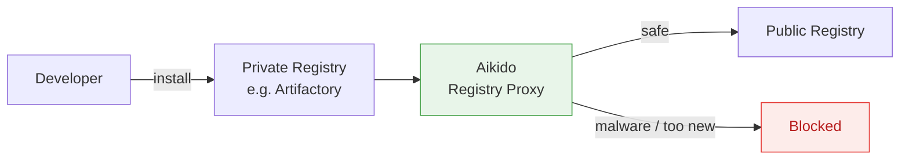

# Registry Proxy

The registry proxy keeps your supply chain safe by blocking malware, enforcing minimum package age, and offering patched versions of vulnerable packages.

Instead of pulling packages directly from the public registry, your private registry routes requests through Aikido's proxy.

Aikido inspects each package before it reaches your environment: blocking known malicious packages and rejecting packages that are too new to be trusted. You can find the proxy URL in the [Aikido UI](https://app.aikido.dev/issues/aikido-libraries/setup-instructions?regionRedirect=1).


Currently npm, PyPI, Maven and NuGet packages are supported


### Blocking malware

The registry proxy blocks packages that contain malware so the malware doesn't reach your development environment, pipelines or production environment.

Packages are blocked based on the Aikido Intel malware feed at [https://intel.aikido.dev/malware](https://intel.aikido.dev/malware).

### Minimum package age

Package versions pushed in the last 48 hours are not available through the Registry Proxy. This gives our malware team time to inspect the new package versions for malware.

The minimum package age can be **configured per ecosystem** (eg. npm, pypi) in the Aikido UI. Go to [Devices > Settings](https://app.aikido.dev/endpoint-protection/settings?regionRedirect=1) and click on the ecosystem to configure the minimum package age. When configured the Registry Proxy uses the devices minimum package age instead of the 48 hours default.

### Patched libraries

[Aikido Libraries](https://help.aikido.dev/autofix-and-remediation/aikido-libraries-overview) alllow you to avoid breaking changes by staying on the same version of the library. Aikido produces patched libraries for old version of the libraries mitigating known critical and high vulnerabilities.

A list of Aikido Libraries can be found in the Aikido UI under [AutoFix > Libraries](https://app.aikido.dev/issues/aikido-libraries?regionRedirect=1). Use AutoFix to create PRs to update to the Aikido Libraries.

## Supported Registries


[jfrog-artifactory.md](https://help.aikido.dev/miscellaneous-integrations/private-registries/jfrog-artifactory)



[azure-devops-artifacts.md](https://help.aikido.dev/miscellaneous-integrations/private-registries/azure-devops-artifacts)



[nexus-repository.md](https://help.aikido.dev/miscellaneous-integrations/private-registries/nexus-repository)



[gcp-artifact-registry.md](https://help.aikido.dev/miscellaneous-integrations/private-registries/gcp-artifact-registry)



[cloudsmith.md](https://help.aikido.dev/miscellaneous-integrations/private-registries/cloudsmith)


## On-Premise Registry Proxy


[on-premise-transparent-proxy.md](https://help.aikido.dev/miscellaneous-integrations/private-registries/on-premise-transparent-proxy)

